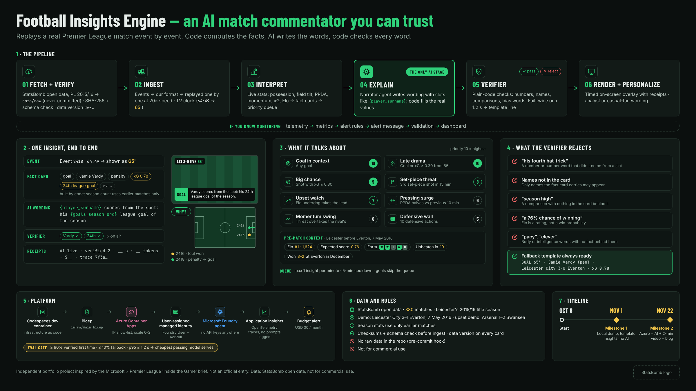

# Football Insights Engine

**An AI match commentator.** It replays a real Premier League match one event at a time and puts short insights on screen about what UK fans already talk about: chance quality, set pieces, pressing, form and late drama. Every number, name and comparison is checked by code before anyone sees it.

> Independent project inspired by the Microsoft × Premier League "Inside the Game" brief. Not an official entry. Data: StatsBomb open data (Premier League 2015/16), not for commercial use.

**Status:** in progress (Oct 8 → Nov 22, 2026). The features below are the design; the [plan](docs/PLAN.md) tracks what's built.

## How it works

Code computes the facts → AI writes the wording → code checks the wording against the facts.

    events → stats → detectors + queue → AI sentence → verifier → studio screen

1. **Code works out the facts**, each with a comparison: this match, the opponent, or the season so far. Deterministic and tested.
2. **Code picks what's worth saying**, using priorities and cooldowns.
3. **AI only writes the wording**, with named slots (`{player_surname}`, `{xg_pct}`) that code fills with the real values. The model never types numbers.
4. **Code checks everything.** If the check fails twice, or the AI takes longer than 1.2 seconds, a template line goes out instead.

## Features

### Live match replay
- A real match (Leicester City 3–1 Everton, 7 May 2016) replays event by event, "live" at 20× speed.
- TV-style match clock: 4:58 shows as 5', added time as 45+n' and 90+n'.
- Live stats: score, possession, field tilt, PPDA (pressing) and momentum.

### Insights

| Insight | Fires when | Priority |
|---|---|---|
| Goal in context | Any goal, with season context ("his 24th league goal") | 10 |
| Late drama | A goal or big chance from 85' | 10 |
| Big chance | A shot with xG of 0.30 or more | 9 |
| Set-piece threat | A team's 3rd set-piece shot in 15 minutes | 8 |
| Upset watch | The team that wasn't the Elo favourite takes the lead | 7 |
| Pressing surge | PPDA halves against the previous 10 minutes | 6 |
| Momentum swing | One team's threatening actions overtake the other's over 5 minutes | 6 |
| Defensive wall | A player reaches 10 defensive actions | 5 |

- **Pre-match context** at kickoff and half-time: Elo rank, the Elo favourite, last 5 results, unbeaten runs and the earlier meeting this season.
- **Priority queue:** at most one insight per match minute, 5-minute cooldown per player and topic. Goals skip the queue.
- **"Why?" pitch view:** every insight plots its evidence events on a pitch.

### Checked AI wording
The verifier is plain Python, never a model. It rejects text with:
- a number or number word ("fourth", "hat-trick") that didn't come from a slot,
- a name that isn't in the fact card,
- a comparison ("most", "season high") with nothing behind it, including win probabilities from Elo (Elo gives an expected score, not a probability),
- a word about a player's body or intelligence with no fact behind it.

### Season context, no future data
- Season totals and ranks use only matches played **before** the replayed one.
- Elo ratings: every club starts at 1500; home advantage +60; K = 20.

### Personalization
- Analyst (numbers-heavy) or casual-fan wording, in English.

### Platform
- **Dev machine as code:** one dev container file, rebuilt identically any time.
- **Docker on Azure Container Apps**, with no StatsBomb data in the image.
- **No API keys anywhere:** a managed identity with the Foundry User role (Microsoft Foundry agents).
- **Infrastructure as code:** Bicep for Azure, a dev container for the dev machine.
- **Traces in Application Insights (OpenTelemetry):** time from event to screen, AI usage, verifier pass rate, template fallback rate. Prompts and responses are never logged.
- **Evaluation gate:** the cheapest model that passes every quality gate serves; switching is one setting.
- **Receipts on every insight:** status, model, latency, tokens, cost, trace ID and evidence IDs.
- **Budget alert** to guard the cost.

## Example: one insight, end to end

    Event 2418, 64:49, shown as 65'   Jamie Vardy scores a penalty (xG 0.78)
    Fact card   {type: goal, clock: "65'", player: "Jamie Vardy", facts: {score: "3-0", xg: 0.78,
                 player_league_goals_season: 24}, compare: {basis: "season to date"}, evidence_ids: [2416, 2418]}
    AI wording  "{player_surname} scores from the spot: his {player_league_goals_season_ord} league goal of the season."
    On screen   "Vardy scores from the spot: his 24th league goal of the season."
    Verifier    Vardy ✓  24th ✓

## Pipeline

| Stage | What it does | AI? |
|---|---|---|
| Fetch | StatsBomb files → `data/raw/` (git-ignored) | No |
| Ingest | StatsBomb events → our Event format → one event at a time | No |
| Interpret | Rolling stats → fact cards → priority queue | No |
| Explain | Top card → slot wording → filled and verified, or a template | Only here |
| Render | Insight → timed overlay JSON with the match clock | No |
| Personalize | Same facts → analyst or casual-fan wording | Via the narrator |

## Run it

Open the repo in GitHub Codespaces: the dev container installs everything. Then:

    pytest                                          # tests
    PYTHONPATH=. streamlit run src/app/main.py      # app (from Milestone 1)

## Data and licence

- **Data:** [StatsBomb open data](https://github.com/statsbomb/open-data), Premier League 2015/16. Credit: StatsBomb. *(StatsBomb logo to be added from their media pack.)*
- The StatsBomb licence allows analysis and publishing conclusions; it forbids redistributing the data and commercial use. No raw or converted event files are in this repo. Details: [docs/DATA.md](docs/DATA.md).
- **Code:** MIT licence (see [LICENSE](LICENSE)). The MIT licence covers the code only, not StatsBomb's data.

## More
- [Project brief](docs/brief.md) · [Plan and progress](docs/PLAN.md) · [Devlog](docs/devlog.md)
