# Slides

The presentation deck for the Football Insights Engine, 18 slides at 1920 × 1080. Each image is rendered from the HTML in [`docs/visuals/src/`](visuals/src/); the brief and facts behind them are in [`docs/visuals/IMAGE-BRIEF.md`](visuals/IMAGE-BRIEF.md). Numbers shown as "__" are filled in once they're measured.

## 01 · Architecture: one container, one live engine, zero keys

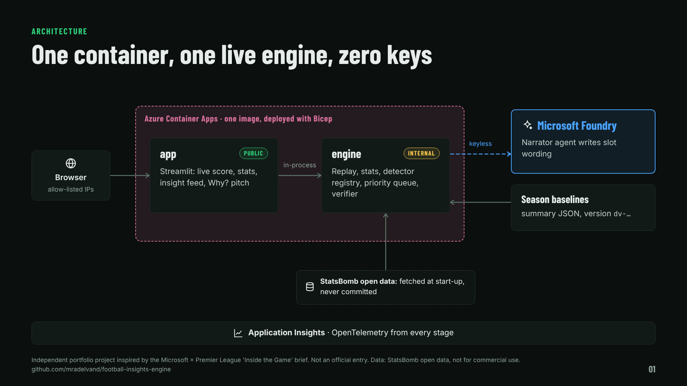

## 02 · Code computes. The model words it.

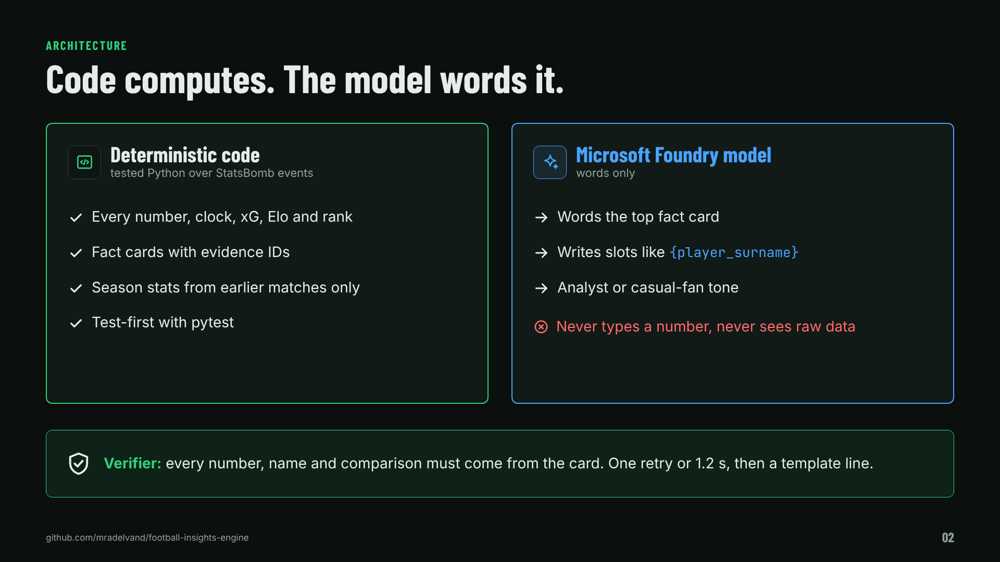

## 03 · From match event to verified insight

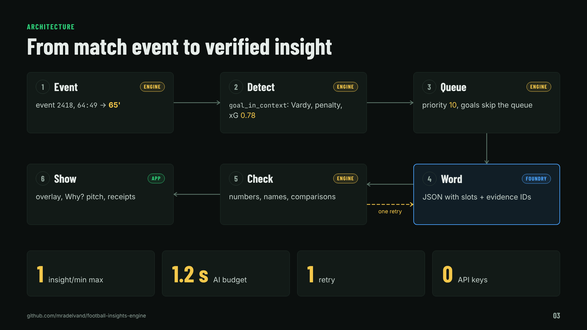

## 04 · Keyless everywhere with Microsoft Entra ID

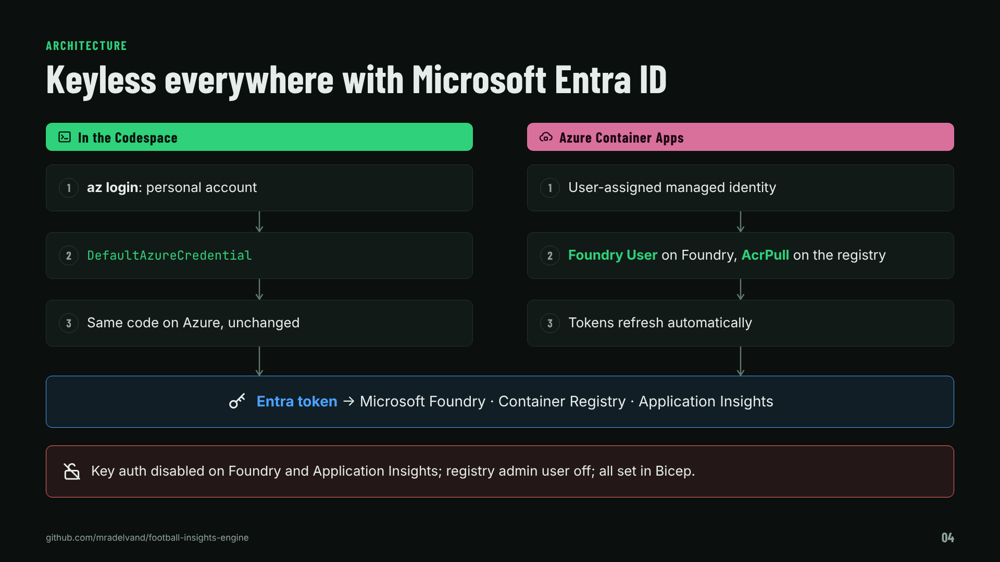

## 05 · The repository contains no match data

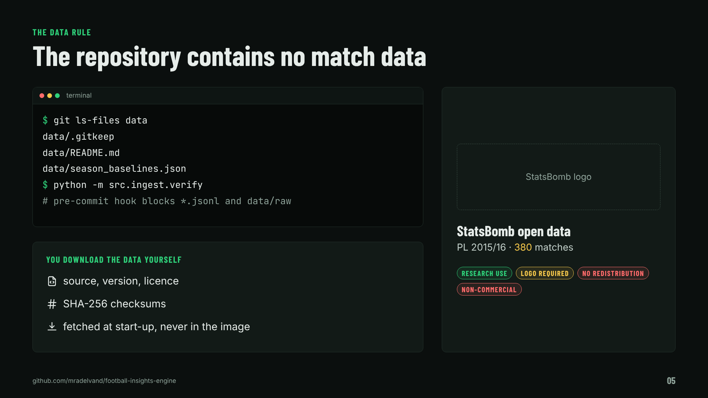

## 06 · Verify, convert, and stamp a data version

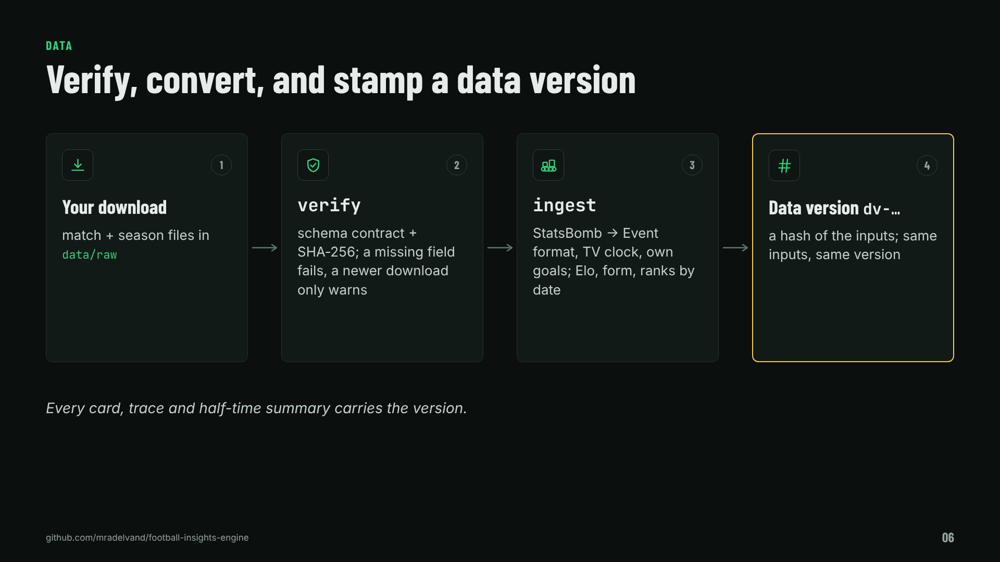

## 07 · Live demo: the four moments

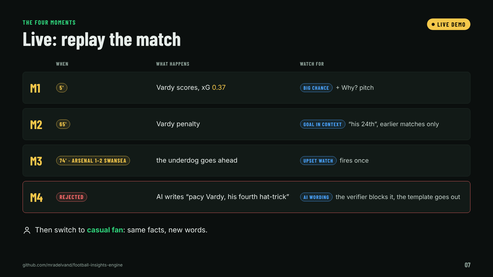

## 08 · When the data can't answer, the app says so

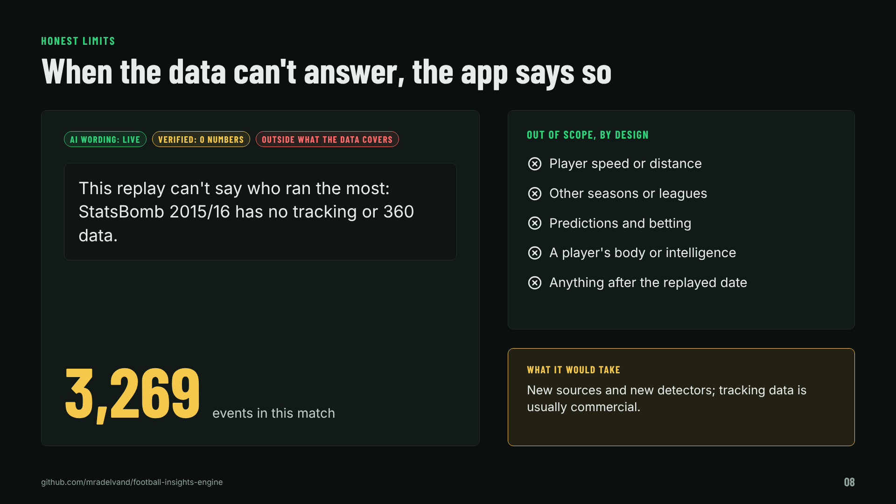

## 09 · Half-time: what the data said

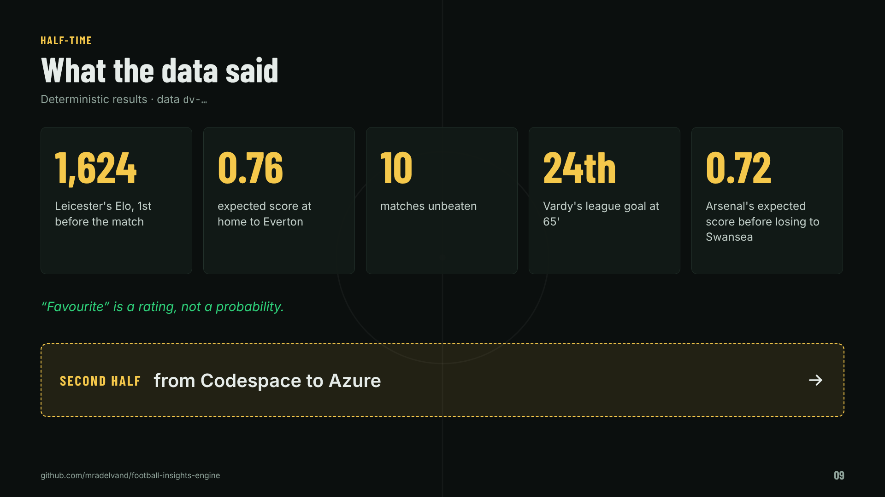

## 10 · Infrastructure as code: same idea, two files

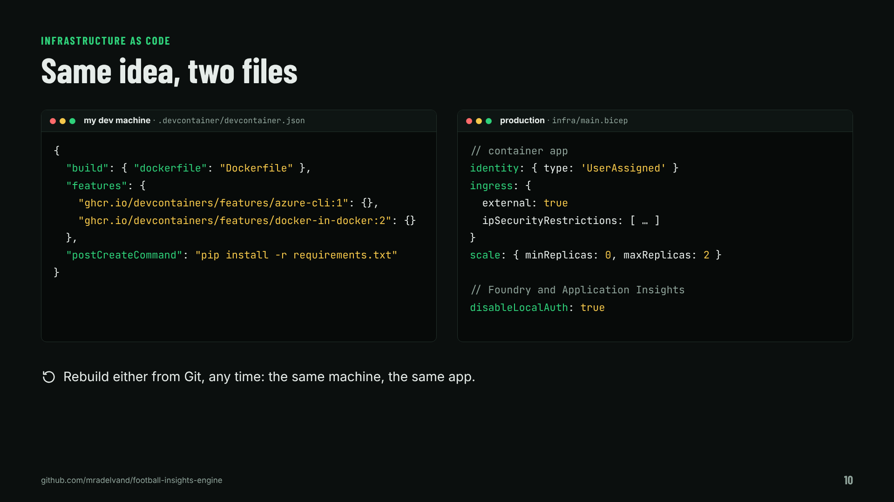

## 11 · Measured: numbers from a full replay (to fill in)

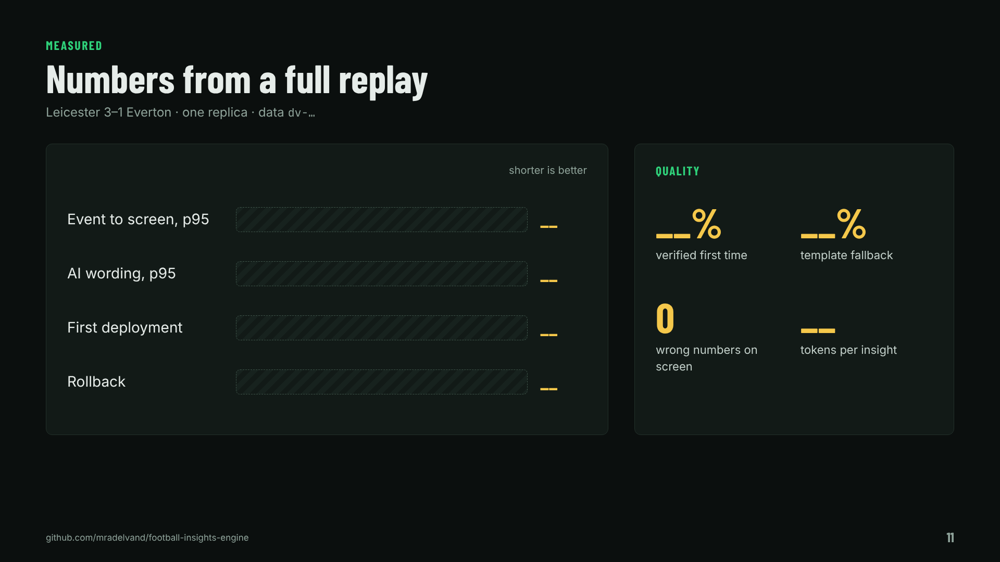

## 12 · Add insight 9 live with Claude Code

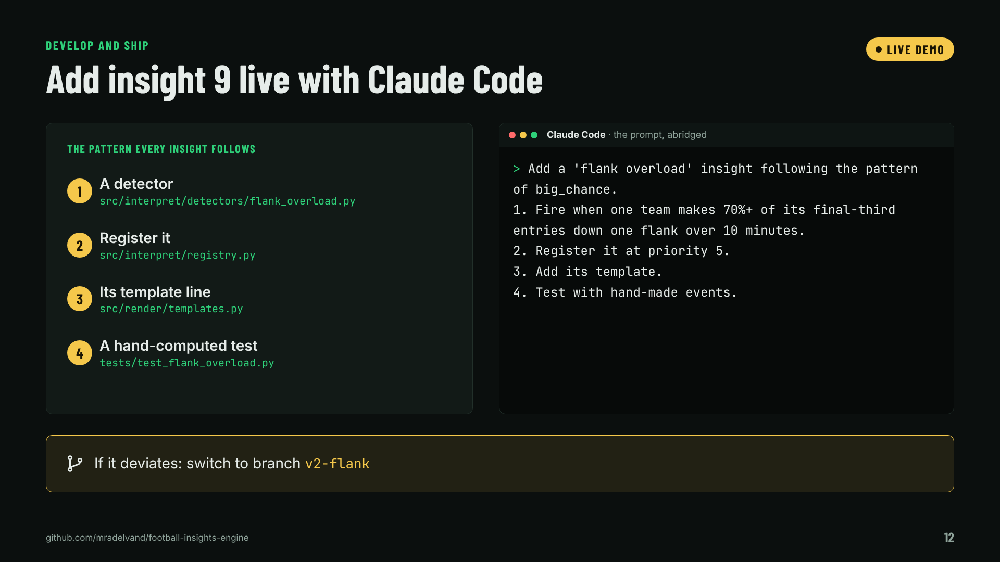

## 13 · Ship v1.1: revisions with traffic weights

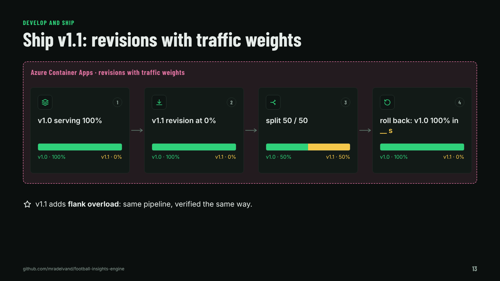

## 14 · Every insight carries its receipts

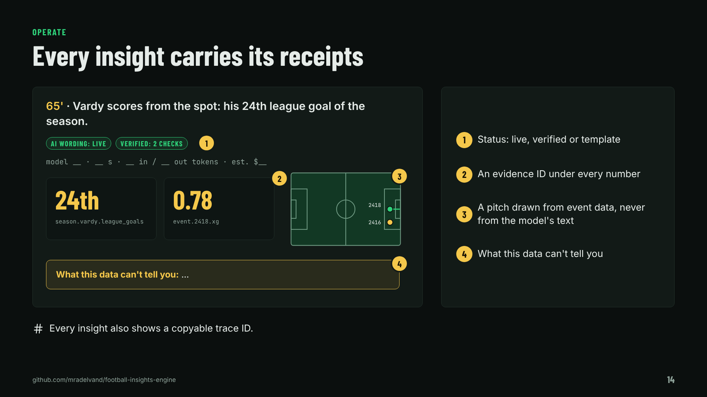

## 15 · One trace, from event to screen

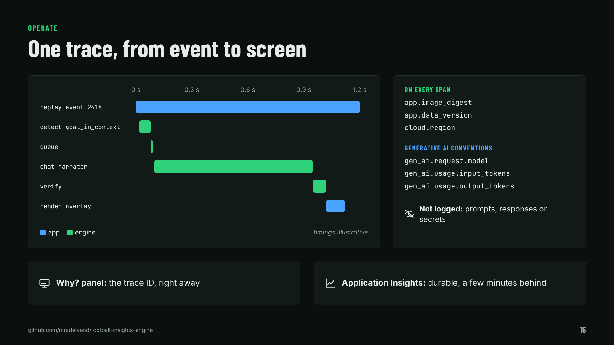

## 16 · Evaluation decides which model serves

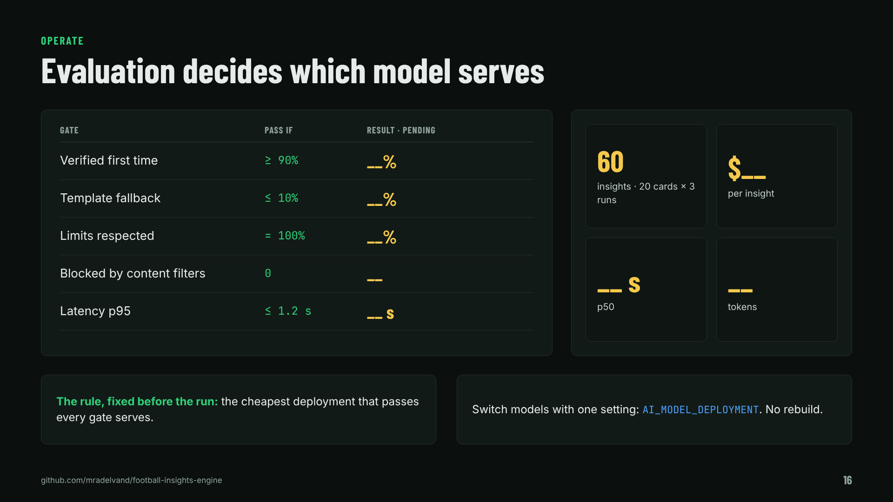

## 17 · Four ways to extend it

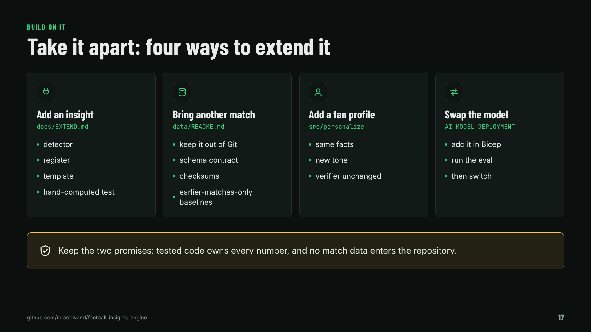

## 18 · Ideas to build on, with the same data

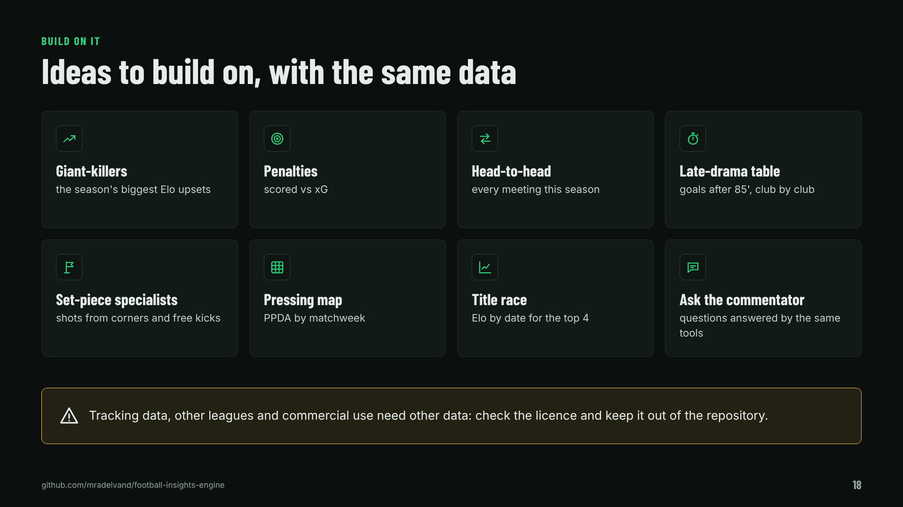
